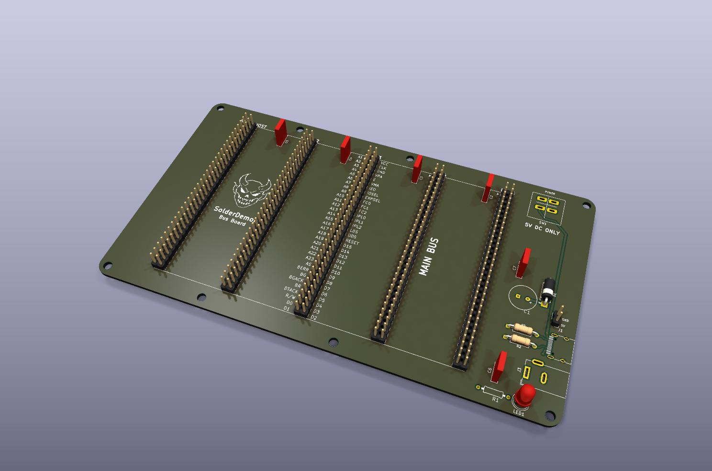
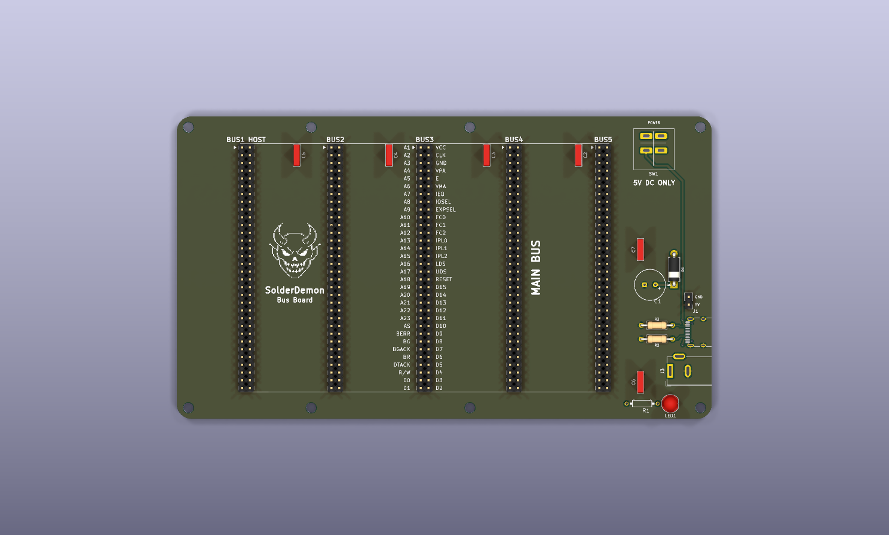
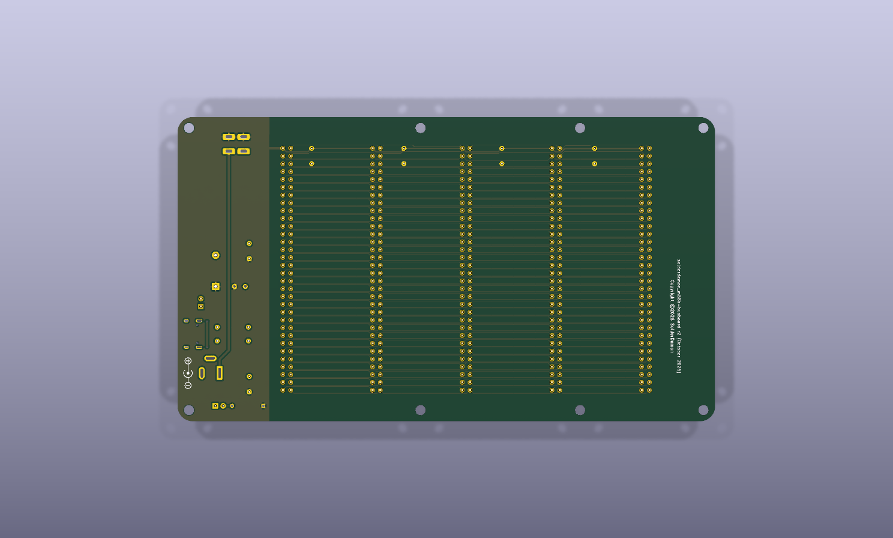

# SolderDemon Bus Board (solderdemon_m68k-busboard)

Revision r2 — the host board stands in the first slot, the power section sits at the right-hand end.

(r1, tagged in git as commit `50e6db7`, had the power section on the left and the host on a ribbon cable.)

A SolderDemon 5-slot backplane with a simple 5V-only power section. The `solderdemon_m68k` host board plugs straight into `BUS1` with its component side facing outwards; `BUS2`–`BUS5` take expansion cards.

Compatible with the rosco_m68k ecosystem; based on the `roscbus-01` bus board by Ross Bamford & Contributors (CERN OHL v1.2).

## Highlights

- **Slot Architecture:** 5 identical slots (`BUS1`–`BUS5`), 2×32 vertical pin headers (2.54 mm / 0.1" pitch), 29.21 mm slot pitch; every slot carries the full 64-pin main bus; pin 1 of each slot is marked with a silkscreen triangle. `BUS1` (labelled `BUS1 HOST`) is the host slot: the 20 mm strip to its left is kept free of tall parts so the host's components can face outwards
- **Power Inputs:** 5V DC only, from either:
  - USB Type-C receptacle (`J4`, power only, 5.1 kΩ CC pull-downs `R2` / `R3`)
  - DC Barrel Jack (`J3`, center-positive)
  - 2-pin 2.54 mm header (`J1`, below the USB-C, wired in parallel with USB `VBUS`)
- **Power Switch:** NKK M2021SS1W01 DPST toggle switch (`SW1`) — one pole switches USB `VBUS` (and `J1`), the other switches the barrel jack
- **Input Protection:** SA5.0A unidirectional TVS diode (`D1`, DO-15 through-hole) across `VCC` / `GND` — clamps over-voltage and conducts on reversed polarity
- **Filtering & Status:** 470 µF bulk reservoir (`C1`), 100 nF bypass capacitors next to the slots (`C2`–`C7`), PWR GOOD LED (`LED1`)
- **Form Factor:** 175 × 99 mm 2-layer PCB, all through-hole components except the USB-C receptacle; power connectors and switch on the right-hand end, away from the host
- **Mounting:** 8× M3 mounting holes (3.2 mm)

## Pinout

All five slots are wired 1:1 to the main bus:

| Pin | Signal | Description | Pin | Signal | Description |
|:---:|:---|:---|:---:|:---|:---|
| **1** | **A1** | Address bus bit 1 | **2** | **VCC** | +5V power rail |
| **3** | **A2** | Address bus bit 2 | **4** | **CPUCLK** | CPU system clock |
| **5** | **A3** | Address bus bit 3 | **6** | **GND** | System ground (0V) |
| **7** | **A4** | Address bus bit 4 | **8** | **VPA** | Valid Peripheral Address |
| **9** | **A5** | Address bus bit 5 | **10** | **E** | 6800-style E clock |
| **11** | **A6** | Address bus bit 6 | **12** | **VMA** | Valid Memory Address |
| **13** | **A7** | Address bus bit 7 | **14** | **MFPIEO** | MFP interrupt enable out (daisy chain) |
| **15** | **A8** | Address bus bit 8 | **16** | **IOSEL** | I/O select |
| **17** | **A9** | Address bus bit 9 | **18** | **EXPSEL** | Expansion select |
| **19** | **A10** | Address bus bit 10 | **20** | **FC0** | CPU function code 0 |
| **21** | **A11** | Address bus bit 11 | **22** | **FC1** | CPU function code 1 |
| **23** | **A12** | Address bus bit 12 | **24** | **FC2** | CPU function code 2 |
| **25** | **A13** | Address bus bit 13 | **26** | **IPL0** | Interrupt priority level 0 |
| **27** | **A14** | Address bus bit 14 | **28** | **IPL1** | Interrupt priority level 1 |
| **29** | **A15** | Address bus bit 15 | **30** | **IPL2** | Interrupt priority level 2 |
| **31** | **A16** | Address bus bit 16 | **32** | **LDS** | Lower Data Strobe |
| **33** | **A17** | Address bus bit 17 | **34** | **UDS** | Upper Data Strobe |
| **35** | **A18** | Address bus bit 18 | **36** | **RESET** | System reset |
| **37** | **A19** | Address bus bit 19 | **38** | **D15** | Data bus bit 15 |
| **39** | **A20** | Address bus bit 20 | **40** | **D14** | Data bus bit 14 |
| **41** | **A21** | Address bus bit 21 | **42** | **D13** | Data bus bit 13 |
| **43** | **A22** | Address bus bit 22 | **44** | **D12** | Data bus bit 12 |
| **45** | **A23** | Address bus bit 23 | **46** | **D11** | Data bus bit 11 |
| **47** | **AS** | Address Strobe | **48** | **D10** | Data bus bit 10 |
| **49** | **BERR** | Bus Error | **50** | **D9** | Data bus bit 9 |
| **51** | **BG** | Bus Grant | **52** | **D8** | Data bus bit 8 |
| **53** | **BGACK** | Bus Grant Acknowledge | **54** | **D7** | Data bus bit 7 |
| **55** | **BR** | Bus Request | **56** | **D6** | Data bus bit 6 |
| **57** | **DTACK** | Data Transfer Acknowledge | **58** | **D5** | Data bus bit 5 |
| **59** | **R/W** | Read / Write | **60** | **D4** | Data bus bit 4 |
| **61** | **D0** | Data bus bit 0 | **62** | **D3** | Data bus bit 3 |
| **63** | **D1** | Data bus bit 1 | **64** | **D2** | Data bus bit 2 |

### Connecting the host and the cards

- **Host board in `BUS1`.** Fit a **right-angle 2×32 socket on the bottom side** of the `solderdemon_m68k` board in the J3 holes, body overhanging the left edge, instead of the vertical header. The host then stands in `BUS1` with its component side facing outwards (left), all its connectors reachable, pins matched 1:1. The socket must be on the bottom side: on the top side the pin order along the row comes out reversed. The host sits about 2 mm lower than the cards because J3 is 5.45 mm from the board edge; its tallest parts reach roughly the left edge of this board.
- **Host on a cable.** With the stock vertical header on J3 the host can instead hang off a 64-way IDC ribbon cable with a socket at both ends, plugged into any slot. The cable is wired 1:1; keep it short (under about 20 cm) because the bus is unbuffered and has a single GND line. Neither header is keyed: match the cable's pin 1 (red stripe) to the triangle on the slot and to pin 1 on J3, otherwise the bus board's own 5V lands on the CPU data lines.
- **Cards.** Expansion cards use a right-angle 2×32 socket on the component side of their right edge, pin 1 at the bottom. Plugged in, every card stands with its components facing left, towards the host slot, so cards look at the back of their left-hand neighbour and the `BUS5` card turns its back to the power section. A card inserted the other way round gets `VCC` on a data line, so check the triangle before powering up.
- **One power source.** Bus pin 2 (`VCC`) is wired straight to the host's 5V rail through the ribbon; there is no diode or jumper separating the two. Power the system either from the host or from this board, never from both.

### Power Interfaces & Control

| Designator | Label | Type / Footprint | Description |
|:---|:---|:---|:---|
| **J1** | 5V IN | Pin header 1×2, 2.54 mm | 5V input for a power cable, pin 1 = +5V (`VBUS_USB`), pin 2 = GND |
| **J3** | Center Positive | Barrel Jack, Würth 6941xx301002 | 5V DC input (center-positive) |
| **J4** | USB-C | HRO TYPE-C-31-M-12, 16P | 5V USB power input, CC1/CC2 pulled down with 5.1 kΩ |
| **SW1** | POWER | NKK M2021SS1W01, DPST toggle | Main power ON / OFF, switches both inputs |
| **D1** | — | SA5.0A, DO-15 (THT) | TVS protection diode across `VCC` / `GND` |
| **LED1** | PWR GOOD | LED 5 mm | `VCC` present indicator |

> **5V only.** There is no voltage regulator on this board. Supply regulated 5V through USB-C, the `J1` header or the barrel jack. If more than ~6V or reversed polarity is applied, `D1` starts conducting and shorts the input. There is no fuse, so this relies on the supply's own over-current protection — a supply without it can destroy `D1`.

> **Several inputs.** With `SW1` ON, all inputs are connected to `VCC`. `J1` is wired directly to USB `VBUS`, so it must never be used while USB-C is plugged in. Use one power source at a time.

## Board Views

| Top Side | Bottom Side |
|:---:|:---:|
|  |  |

## Bill of Materials (BOM)

| Reference | Value | Package / Footprint | Notes |
|:---|:---|:---|:---|
| **BUS1-1–BUS5-1** | Conn_02x32 | Pin header 2×32, 2.54 mm, vertical | Bus slots |
| **J1** | 5V IN | Pin header 1×2, 2.54 mm, vertical | 5V power input header |
| **J3** | Jack-DC | Barrel jack, Würth 6941xx301002 | 5V DC input |
| **J4** | USB-C 16P | HRO TYPE-C-31-M-12 | USB Type-C power receptacle |
| **SW1** | M2021SS1W01 | NKK M-series DPST ON-OFF toggle switch | Main power switch |
| **D1** | SA5.0A | DO-15, Axial P10.16 mm (THT) | Unidirectional TVS diode |
| **LED1** | LED 5 mm | Radial D5.0 mm (THT) | PWR GOOD indicator |
| **C1** | 470 µF | Radial electrolytic, P3.5 mm, D10 mm | Bulk reservoir capacitor |
| **C2–C7** | 100 nF | Rectangular film/ceramic, P5.00 mm | Bypass capacitors |
| **R1** | 1 kΩ | Axial DIN0207, P10.16 mm | LED1 current-limiting resistor |
| **R2, R3** | 5.1 kΩ | Axial DIN0207, P10.16 mm | USB-C CC1 / CC2 pull-down resistors |
| **H1–H8** | Mounting Hole | 3.2 mm M3 | Mounting holes |
| **LOGO1** | SolderDemon logo | Silkscreen only | Board-only graphic, not in the BOM |

Machine-readable BOM: [solderdemon_m68k-busboard-bom.csv](solderdemon_m68k-busboard-bom.csv).

## Manufacturing & Hardware Files

- **KiCad Project (KiCad 10):** `solderdemon_m68k-busboard.kicad_pro`, `solderdemon_m68k-busboard.kicad_sch`, `solderdemon_m68k-busboard.kicad_pcb`
- **Footprint Library:** `solderdemon_m68k-busboard.pretty/` (bus header, capacitor, resistor and power switch footprints, SolderDemon logo)
- **Logo:** [logo.png](logo.png) is the source; `python tools/make_logo.py [height_mm]` regenerates `SolderDemon_Logo.kicad_mod` from it (run with KiCad's Python, it needs Pillow)
- **Schematic PDF:** [solderdemon_m68k-busboard.pdf](solderdemon_m68k-busboard.pdf)
- **Gerbers:**
  - Ready-to-order archive: [solderdemon_m68k-busboard_production_gerber.zip](solderdemon_m68k-busboard_production_gerber.zip)
  - Unpacked layers and drill file in [gerber/](gerber/) folder
- **PCB Specs:** 2-layer board, 175 × 99 mm, 1.6 mm thickness, standard 1 oz copper, HASL / ENIG finish
- **Design Verification:** [DRC Report](solderdemon_m68k-busboard-drc.rpt) (0 errors, 0 unconnected; the 40 warnings are silkscreen overlaps and clipping, footprints and fields that differ from the KiCad library copies, and the intentionally unconnected USB-C data pads), [ERC Report](solderdemon_m68k-busboard-erc.rpt) (0 errors, 1 library warning)

## License

- **Hardware:** CERN Open Hardware Licence v1.2 ([LICENCE.hardware.txt](LICENCE.hardware.txt)).
- **This revision (SolderDemon r2):** Copyright © 2026 SolderDemon.
- **Original design:** Copyright © 2020 Ross Bamford & Contributors.
